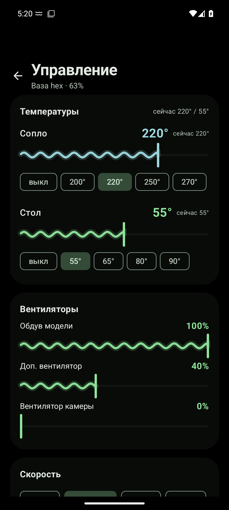
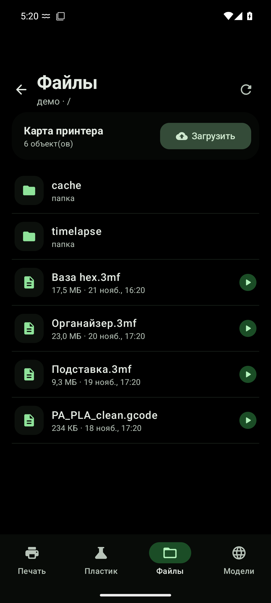
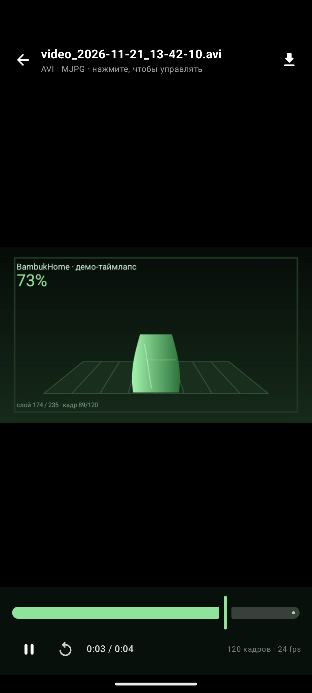

# BambukHome

[](https://developer.android.com)
[](https://kotlinlang.org)
[](https://developer.android.com/jetpack/compose)
[](LICENSE)

**Локальное управление принтерами Bambu (P1S / P1P / X1 / A1 / H2D и совместимыми) с Android-телефона.**
Управление идёт напрямую по домашнему Wi-Fi, без облака и Raspberry Pi.
Облачный аккаунт, реклама и трекеры не нужны.

Telegram-канал: https://t.me/BambukHome

## Что нового в 2.0.0

- **Вторая стабильная версия.** Ветка 2.0.0 закрепляет накопленные изменения
  после 1.1.0 и убирает экспериментальные элементы.
- **Размеры Clawd.** В настройках порядок теперь логичный:
  Мини → Маленький → Средний → Большой. Самый маленький размер стоит первым.
- **Пункт «Гравитация» удалён.** Он не работал предсказуемо; вместо переключателя
  питомец всегда естественно падает после переноса или броска.
- **«О приложении» обновлено** до версии 2.0.0.
- Версия приложения — **2.0.0**.

## Что нового в 1.1.6

- **Стабильные индикаторы.** Убраны MD3Core, md3_loader и волнистый загрузчик;
  вместо него обычные спокойные индикаторы Material 3.
- **Удалены «Модели», MakerWorld и стили иконок Plumpy/Fluent.** Осталась своя
  иконка приложения. Файлы загружаются только через «Файлы».
- **Управление из камеры.** В камере есть режим перемещения стола и головы,
  парковка, шаг 1/10/50 мм. Температуры и вентиляторы остаются в «Управлении».
- **Камера стала удобнее.** Приближённую картинку можно двигать пальцем,
  как видео в Telegram; кнопки масштаба стали компактнее.
- **Скачивание видео исправлено.** Файл действительно сохраняется в
  «Загрузки/BambukHome», показывается прогресс и понятный результат.
- **Очистка SD.** В «Файлах» появилась очистка пользовательских файлов:
  3MF, STL, таймлапсы и фото. Файлы .gcode и системные папки не трогаются.
- **Clawd стал умнее.** По нажатию он рассказывает новый факт и совет по
  3D-печати, обслуживанию и материалам. Более 170 000 локальных карточек,
  без сети и ИИ, без повторов до исчерпания колоды.
- **Clawd: размер и пузырь.** Добавлен размер «Мини», текст ближе к питомцу;
  в 2.0.0 нерабочий переключатель гравитации удалён.
- **Ферма на рабочем столе.** При 3+ профилях можно вывести кнопку фермы
  в шапку рабочего стола.
- **Умный свет камеры.** Если вы сами выключили свет, вход в камеру включает
  его, а выход или сворачивание приложения — выключает. Если свет был включён,
  приложение его не трогает.
- **Уведомления не копятся.** Завершение, пауза и ошибка обновляют одну
  карточку своего типа и исчезают через час.
- **Резервная копия настроек.** Понятное название вместо «зашифрованной копии».
- Версия приложения — **1.1.6**.

## Что нового в 1.1.5

- **Ферма принтеров.** Отдельный экран со статусами, прогрессом, температурами
  и ошибками. Пауза, продолжение, стоп и свет — прямо из карточки. Чтобы не
  перегружать Wi-Fi и батарею, одновременно мониторятся до 8 профилей.
- **Обслуживание.** Регламент с напоминаниями (сопло, пластина, ремни, смазка,
  вентиляторы, PTFE, силикагель), короткие инструкции, журнал ремонтов и
  локальный справочник HMS с поиском по коду и словам.
- **История и статистика.** Успешные и неудачные печати, время, оценка энергии
  и стоимости, график за 7 дней. Тариф можно указать в настройках.
- **Понятные уведомления.** HMS переводится в человеческое описание, в шторке
  есть «Пауза / Продолжить / Стоп», уведомления группируются по принтеру.
- **Виджеты и быстрый доступ.** Виджеты 2×1 и 4×2, плитка быстрых настроек,
  отдельные ярлыки «Ферма» и «Камера».
- **Быстрое подключение.** Поиск принтеров через mDNS, QR-код с адресом и
  серийником, зашифрованный экспорт и импорт профилей и настроек (AES-256-GCM).
- **Безопасность и большие экраны.** Биометрическая блокировка, скрытие камеры
  в недавних приложениях, боковая навигация на планшетах и складных устройствах,
  объявления статуса для TalkBack.
- **Камера.** Опция скрытия превью, экспериментальный локальный детектор соплей
  (по умолчанию выключен, может ошибаться при смене освещения).
- **Калибровка.** Пошаговые мастера первого слоя, потока, pressure advance и
  температуры с готовыми G-code-блоками.
- **Индикатор данных.** В разделе пластика появился спокойный индикатор
  ожидания ответа принтера вместо пустого экрана.
- Версия приложения — **1.1.5**.

## Что нового в 1.1.4

- **Номера деталей больше не слипаются.** Для 3MF с одинаковыми именами
  (`lockS2.stl` × 3) bbox-объекты теперь разбираются по порядку, а не
  перезаписываются одним именем. На схеме каждая деталь получает свой номер,
  совпадающий с номером в списке.
- Превью пластины из 3MF остаётся фоном, поверх него рисуются реальные bbox
  деталей и подписи.
- Версия приложения — **1.1.4**.

## Что нового в 1.1.3

- **Пропуск деталей на реальных 3MF.** Пластина больше не остаётся пустой:
  приложение читает `Metadata/plate_N.json` (bbox объектов) и превью
  `Metadata/plate_N.png`, а при отсутствии геометрии показывает детали
  понятными блоками с номерами. Схема и список синхронизированы.
- **Запасной разбор старых 3MF.** Если нет ни мешей, ни bbox, детали
  раскладываются сеткой, а не пропадают; номера на схеме совпадают со списком.
- **Выгрузка прутка.** Исправлена contradictory-ситуация «Не заряжена» +
  «ЗАПРАВЛЕНА»: кнопка «Выгрузить» активна, если принтер сообщает внешнюю
  катушку, даже без полных данных о ней. После команды запрашивается свежий статус.
- **P1S/P1P без датчика камеры.** Несуществующая температура камеры больше не
  показывается на главном экране; слово «датчик» убрано.
- **Имя человека для Clawd.** В настройках Clawd можно указать своё имя, и он
  обращается по нему, а не по имени принтера.
- **Удаление своей иконки.** В разделе «Иконки» сохранённое фото можно удалить.
- Версия приложения — **1.1.3**.

## Что нового в 1.1.2

- **Пропуск деталей стал понятным.** На схеме пластины теперь видны контуры
  деталей и номера, совпадающие со списком; если в старом 3MF нет геометрии,
  используется положение из build/assemble или аккуратная сетка. Пластину
  можно масштабировать глазами, отмечать детали нажатием.
- **Спокойный индикатор загрузки.** В пропуске деталей и небольших спиннерах
  больше нет дёрганого круга — плавное кольцо без пульсации.
- **Выгрузка прутка исправлена.** Кнопка «Выгрузить» больше не блокируется,
  если принтер сообщает «заправлена», но не отдаёт данные катушки; после
  команды приложение запрашивает свежий статус.
- **P1S без датчика камеры.** У P1S/P1P убран несуществующий датчик
  температуры камеры; лишняя плитка и слово «датчик» с рабочего стола убраны.
- **Имя для Clawd.** В настройках Clawd можно указать имя человека — питомец
  обращается по нему, а не по имени принтера.
- **Свою иконку можно удалить.** В разделе «Иконки» появилась кнопка удаления
  сохранённого фото.
- Версия приложения — **1.1.2**.

## Что нового в 1.1.1

- **Без ложных ошибок филамента.** Датчик внешней катушки при заправке и выгрузке
  больше не присылает уведомление об ошибке, если печать не идёт.
- **Обновление жестом.** Рабочий стол обновляется pull-to-refresh с аккуратным
  индикатором, без перегруженной шапки.
- **Скачивание видео из файлов.** У каждого таймлапса появилась кнопка загрузки,
  не нужно открывать плеер.
- **Настройки по папкам.** Принтер, внешний вид, печать, сервисы, Clawd, иконки,
  о приложении — каждая группа открывается отдельно.
- **Подтверждение управления.** Случайное движение ползунка температуры или
  вентилятора теперь спрашивает подтверждение.
- **До 200 принтеров.** Профили фермы, поиск по имени/IP/serial и компактный
  переключатель на рабочем столе.
- **AMS-влажность по датчику.** Показывается сырой процент, если прошивка его
  отдаёт, иначе уровень 1–5, с подсказкой «сухо / норма / влажно».
- **Clawd.** Локальный питомец из clawd_pet: без ИИ, по умолчанию выключен,
  живёт внизу, не мешает кнопкам. Ест пиксели, спит, реагирует на печать,
  рассказывает факты и советы по 3D-печати. Более 170 000 сочетаний
  (факты × советы) — запас на 100+ лет.
- **Своя иконка.** Фотографию можно закрепить как отдельный ярлык-иконку.
- **Живая камера.** Pinch-to-zoom, панорамирование и кнопки до 4×.
- **Новая загрузка.** Стабильные стандартные индикаторы Material 3.
- Версия приложения — **1.1.1**.

## Зачем

Телефон всегда под рукой, принтер стоит рядом, а для базовых задач не хочется поднимать ПК или Raspberry Pi, заводить аккаунт и зависеть от интернета. BambukHome закрывает локальный сценарий: подключился по IP, видишь статус, управляешь печатью, AMS, камерой и файлами. Всё работает напрямую в домашней сети.

- **Пакет:** `ru.layerpilot`
- **Android:** 8 (API 26) и новее (targetSdk 35); проверено на Android 15
- **Языки:** русский, английский, немецкий, французский, испанский, итальянский,
  португальский, польский, турецкий, китайский
- **Стек:** Kotlin, Jetpack Compose, Material 3 (Material You)
- **Сборка:** `app-release.apk` (подписан), debug — `app-debug.apk`

## Что умеет

### Рабочий стол
- Настройка порядка карточек: печать, быстрые действия, температуры, AMS,
  ошибки, камера и файлы. Можно скрывать ненужные блоки.

### Несколько принтеров
- Профили принтеров с именами, моделями, IP, кодом доступа и serial.
- Переключение активного принтера одним касанием на главном экране.
- Управление профилями: добавить, изменить, удалить, подключиться.
- У каждого профиля свои демо-настройки и настройки AMS.

### Печать и контроль
- Прогресс, слой, оставшееся время, ETA, стадия печати, HMS-ошибки.
- Пауза, продолжение, остановка с подтверждением.
- Скорость 4 режима (тихий/стандарт/спорт/безумный).
- Температуры сопла и стола: слайдеры, пресеты, live-показания.
- Вентиляторы модели, дополнительный и камеры (0–100 %).
- Свет камеры.
- Перемещение X/Y/Z с шагом 1/10/50 мм, парковка, экструзия/втягивание.
- Произвольный G-code (с очисткой комментариев).
- Пропуск деталей: из 3MF на SD читается пластина и реальные контуры объектов;
  детали можно отмечать прямо на схеме стола, отправка через `skip_objects`.
  Понимает мультипластинчатые проекты Bambu Studio (сетка пластин с зазором 20 %).

### Пластик и AMS
- Полная поддержка AMS: до 4 слотов на юнит, несколько юнитов, влажность и температура.
- Заправка/выгрузка катушки (`ams_change_filament`), ответы мастеру (`ams_control`).
- Режим **без AMS**: внешняя катушка (слот 254) — заправка, выгрузка, остаток.
- Сопоставление цветов при печати: `use_ams` + `ams_mapping` по числу филаментов в 3MF.
- Честное отображение остатка, бренда, линии и температур.
- Кольца остатка по слотам, средний остаток, предупреждение о катушках ≤15 %.

### Файлы
- SD-карта принтера по FTPS 990 (implicit TLS + session reuse): список, папки, загрузка, скачивание, удаление.
- Загрузка `.3mf`/`.gcode` с телефона через системный файловый picker, с прогрессом.
- Запуск печати с параметрами: таймлапс, выравнивание стола, калибровка потока и вибраций, AMS-маппинг.
- Импорт 3MF: превью пластины, число цветов и пластин.
- Скачивание видео и файлов в «Загрузки/BambukHome» с прогрессом.
- Очистка SD от 3MF, STL, таймлапсов и фото с сохранением `.gcode`.

### Камера
- Поток по TLS 6000 (80-байтный auth-пакет, кадры JPEG).
- Полноэкранный режим, снимок в галерею (`Pictures/LayerPilot`), свет камеры.
- Управление столом и головой без выхода из камеры.
- Умный свет: включается при входе, если вы выключили его сами, и гаснет при выходе.
- Приближение и панорамирование картинки пальцами.

### Таймлапсы
- Встроенный плеер: AVI/MJPG читается своим декодером (Android не умеет такой контейнер),
  MP4/MKV — через Media3.
- Пауза, перемотка, время, кадры, fps; демо-таймлапс генерируется на телефоне.

### Уведомления
- Тихий прогресс в шторке: проценты, слой, остаток, полоса прогресса.
- Foreground-service держит MQTT живым, пока идёт печать.
- Звук только у завершения и ошибок; прогресс и пауза — без звука.

### Внешний вид и настройки
- Material You: динамические цвета Android 12+ или фирменная зелёная схема.
- Тёмная/светлая/системная тема.
- **AMOLED-режим**: чистый чёрный фон.
- Любой цвет приложения: системный Material You, фирменный зелёный или свой оттенок (ползунок + палитра).
- Масштаб интерфейса 85–130 %, форма волны (тонкая/толстая, прямая/волнистая).
- Шрифты: системный, Ndot 77 JP Extended или свой .ttf/.otf/.ttc из памяти телефона.
- Профили печати: черновик, стандарт, качество, ночной (скорость + калибровки).
- Ручная правка статистики: общие часы и число завершённых печатей.
- Уведомления: завершение, пауза, ошибки HMS.
- Настройки печати по умолчанию, папка загрузки, демо-режим, сброс данных.
- «О принтере»: прошивка, сопло, Wi-Fi, серийник, сборка, статистика часов и печатей.
- «О приложении»: контакты автора, бесплатность и приватность.
- Демо-режим с AMS и без — можно посмотреть всё без принтера.

## Скриншоты

| Обзор | Управление | AMS |
|---|---|---|
|  |  |  |
| **Файлы** | **Камера** |
|  |  |
| **Настройки** | **Плеер** |
|  |  |

Остальные: `00_connect.png`, `10_printer_info.png`, `11_custom_color.png`,
`12_custom_font.png`, `13_scale.png`, `14_live_toggle.png`.

## Как подключиться

1. На принтере: **Настройки → Сеть** — узнать IP, код доступа (8 символов) и серийный номер.
2. Включить **LAN-режим** (LAN Only Mode), иначе MQTT/FTPS могут быть закрыты.
3. В BambukHome ввести IP, код доступа, серийный номер и модель.
4. Нажать «Подключиться по Wi-Fi».

Порты: MQTT 8883 (TLS), FTPS 990 (implicit TLS), камера 6000 (TLS).
Если прошивка использует нестандартный FTPS-порт, он меняется в настройках («Порт FTPS»).
Сертификат принтера самоподписанный — приложение доверяет ему только в локальной сети,
как Bambu Studio и эталонный бот.

## Сборка

```bash
./gradlew assembleRelease   # подписанный APK
./gradlew assembleDebug     # отладочный APK
```

APK: `app/build/outputs/apk/release/app-release.apk`.

Ключ подписи и `keystore.properties` в репозиторий не входят — добавьте свои локально.
Для публикации в магазине замените ключ и название (Bambu — чужая торговая марка).

## Архитектура
```
data/
  video/AviMjpeg.kt            собственный AVI/MJPG-декодер для таймлапсов
  video/DemoTimelapse.kt       генератор демо-видео
  stats/StatsRepository.kt     локальные часы печати и счётчик
  notifications/               тихий прогресс + foreground-service
  locale/Lang.kt               словарь 10 языков
  model/PrinterSnapshot.kt     разбор отчёта MQTT, AMS, HMS, стадии
  printer/MqttPrinterClient.kt Paho MQTT/TLS 8883, delta-merge в репозитории
  printer/PrinterRepository.kt команды, переподключение, демо-движок
  files/FtpsClient.kt          собственный implicit-FTPS с TLS session reuse
  files/PrinterFtpClient.kt    список/загрузка/скачивание/удаление
  camera/CameraClient.kt       TLS-поток кадров, auth-пакет, сохранение
  models/PlateInspector.kt     пластина, bbox и детали для пропуска
  settings/SettingsRepository.kt DataStore
ui/
  AppViewModel.kt              состояние, команды, передача файлов, демо
  theme/                       Material You, AMOLED, Ndot
  components/                  волновые индикаторы, карточки, чипы
  screens/                     Подключение, Обзор, Управление, Пластик,
                               Файлы, Камера, Ферма, Настройки, О принтере
  components/WavySlider.kt     M3-слайдер с волной на активной части
```

## Обновление

Пакет `ru.layerpilot`, ключ подписи не меняется — новые версии ставятся поверх старых.
Настройки, профили принтеров, выбранный шрифт и статистика сохраняются.
APK новых версий — в разделе Releases.

## Что проверено

- Release-сборка, подпись, установка и запуск на Android 15 (API 35); минимальная версия — Android 8 (API 26).
- Демо-режим с AMS и без AMS: печать, пауза/стоп, температуры, вентиляторы, скорость.
- Импорт 3MF: превью пластины, 2 цвета, список объектов для пропуска.
- Собственный FTPS-клиент против тестового implicit-FTPS сервера: список, загрузка,
  скачивание, удаление, TLS 1.2 с повторным использованием сессии, русские имена файлов.
- Загрузка файла с телефона через системный picker, сохранение скачанного в «Загрузки/BambukHome».
- Камера (демо-поток), AMOLED-чёрный, светлая/тёмная темы, переключение на лету.
- Новый плеер AVI/MJPG, Media3 для MP4, перемотка и кадры.
- Тихий прогресс в шторке и foreground-service на Android 15.
- 10 языков интерфейса; основные экраны и настройки переведены, длинные технические
  подсказки имеют английский fallback.
- Обновления ставятся поверх предыдущих версий: настройки, профили и демо-режим сохраняются.
- Свой цвет, масштаб интерфейса (85–130 %), Ndot 77, свой шрифт из памяти телефона, профили печати.
- Тихий прогресс в шторке проверен на Android 8 и 15.
- Живой принтер, MQTT-команды и реальная TLS-камера требуют проверки на P1S — в среде разработки его нет.

## Ограничения (честно)

- Протокол неофициальный. После обновлений прошивки отдельные команды могут измениться.
- Проверка на живом принтере — за пользователем: в среде разработки нет P1S.
- STL не печатается напрямую: принтеру нужен нарезанный `.3mf`/`.gcode`.
- Мультицвет требует, чтобы нужные катушки были в AMS; маппинг задаётся перед печатью.
- Удаление пользовательских файлов с SD не затрагивает `.gcode` и системные папки.
- P1S/P1P отдают камеру по MJPEG (порт 6000). H.264 и субпоток поддерживаются
  не всеми прошивками, поэтому приложение не изображает их наличие.
- Ферма одновременно держит до 8 MQTT-подключений: так меньше нагрузка на Wi-Fi
  и батарею. Остальные профили открываются по нажатию.
- Детектор соплей — эвристика по кадрам, а не нейросеть. Он выключен по умолчанию
  и может ругаться при резкой смене освещения.

## Приватность

BambukHome не содержит рекламы, аналитики и трекеров. IP, код доступа, serial,
профили, настройки и статистика хранятся только на телефоне. Аккаунт Bambu Lab
опционален: пароль не сохраняется, токен входа шифруется. Подробнее — в
[PRIVACY.md](PRIVACY.md).

## Поддержка

- Telegram-канал: [@BambukHome](https://t.me/BambukHome)
- Вопросы и баги — в Issues или в Telegram.
- Перед вопросом укажи модель принтера, прошивку, версию Android и шаги.
- Не прикладывай код доступа, serial и личные данные.

## Лицензия

BambukHome Freeware License. См. [LICENSE](LICENSE).

## Дисклеймер

BambukHome — независимый клиент. Не связан с Bambu Lab. Названия Bambu Lab,
Названия моделей принтеров используются только для обозначения совместимости.
Протокол неофициальный; используйте приложение на свой риск и проверяйте
параметры перед важной печатью.

## English summary

BambukHome is an unofficial Android client for local control of Bambu Lab 3D
printers over home Wi-Fi. It supports P1S/P1P/X1/A1/H2D and compatible models:
print progress and control, temperatures, fans, AMS, files over FTPS, camera,
timelapses, quiet notifications, multiple printers and local farm mode.
No ads or subscriptions. Android 8+. Models and MakerWorld were removed in 1.1.6. See [PRIVACY.md](PRIVACY.md) and
[LICENSE](LICENSE).

> Not affiliated with Bambu Lab. Bambu Lab and MakerWorld are trademarks of
> their respective owners.
