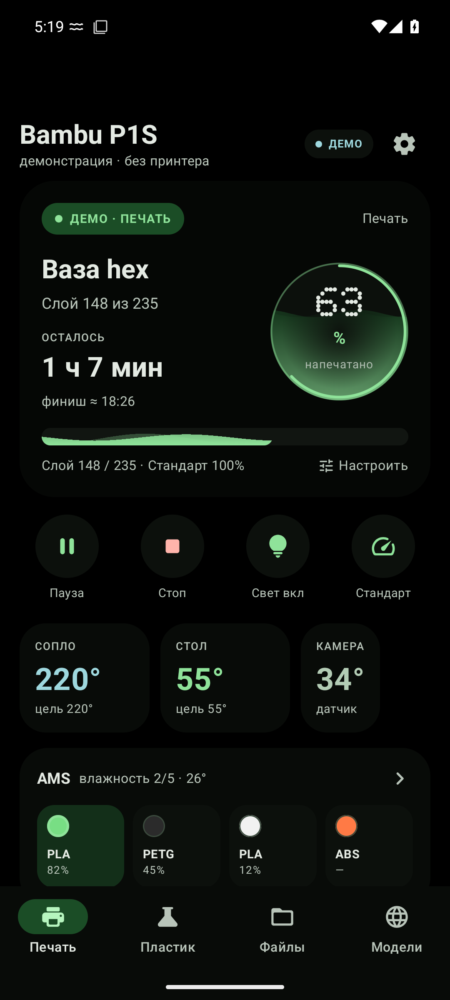
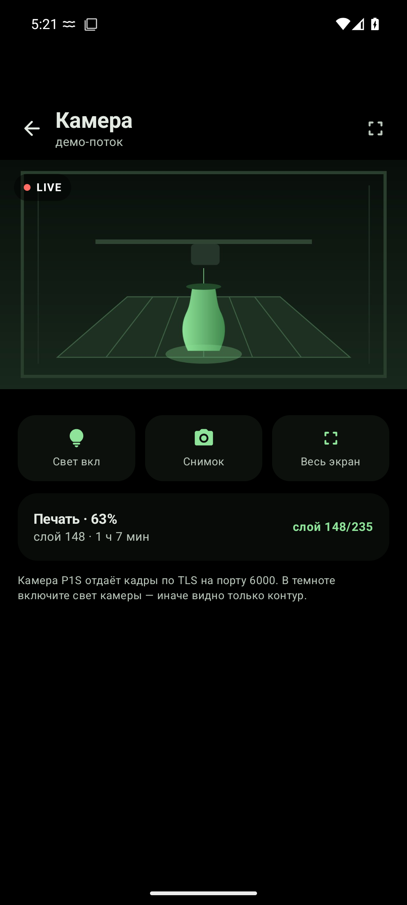
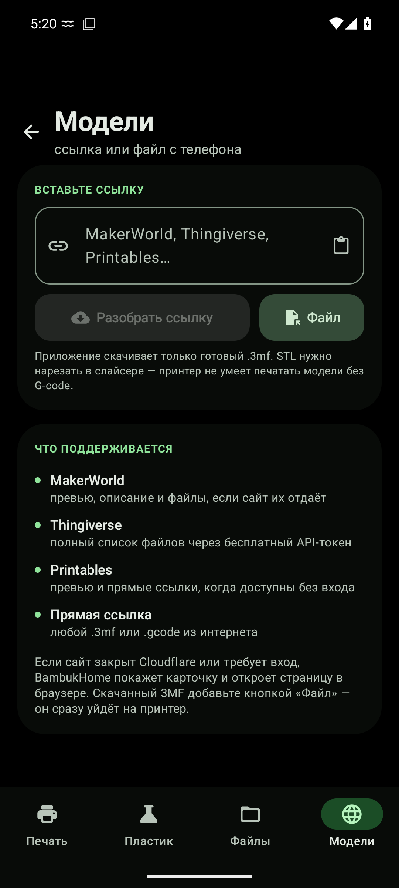
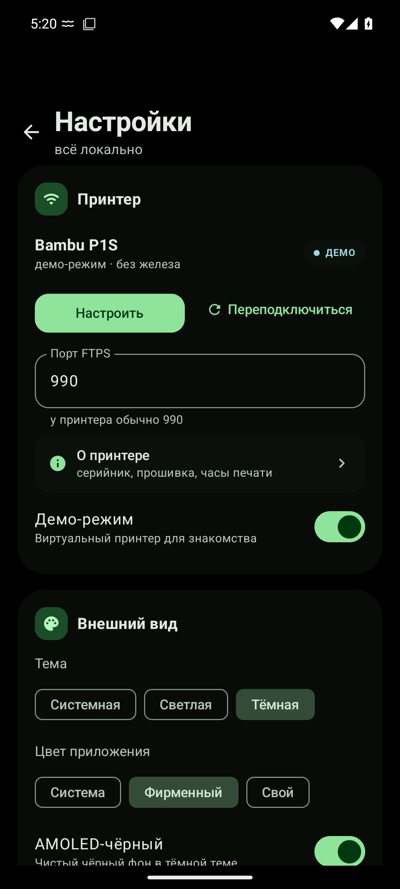
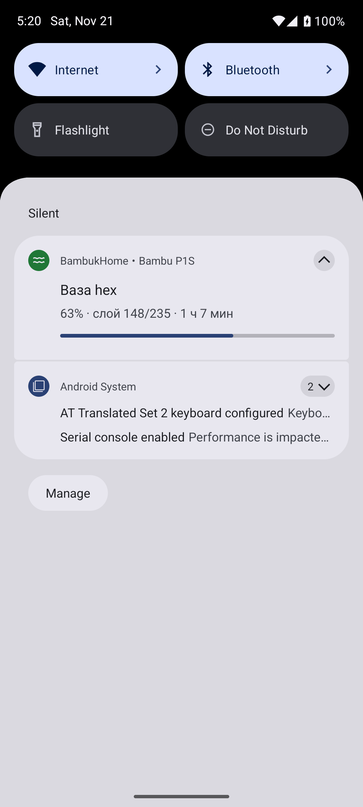

# BambukHome

[](https://developer.android.com)
[](https://kotlinlang.org)
[](https://developer.android.com/jetpack/compose)
[](LICENSE)

**Локальное управление принтерами Bambu (P1S / P1P / X1 / A1 / H2D и совместимыми) с Android-телефона.**
Управление идёт напрямую по домашнему Wi-Fi, без облака и Raspberry Pi.
Аккаунт Bambu Lab нужен только для дополнительного раздела MakerWorld — его можно не включать.

Telegram-канал: https://t.me/BambukHome

## Зачем

Телефон всегда под рукой,и не хочеться заводить аккаунт и зависеть от интернета. BambukHome закрывает локальный сценарий: подключился по IP, видишь статус, управляешь печатью, AMS, камерой и файлами. MakerWorld и облачный аккаунт — отдельный опциональный слой, а не обязательное условие.

- **Пакет:** `ru.layerpilot`
- **Android:** 8 (API 26) и новее (targetSdk 35); проверено на Android 15
- **Языки:** русский, английский, немецкий, французский, испанский, итальянский,
  португальский, польский, турецкий, китайский
- **Стек:** Kotlin, Jetpack Compose, Material 3 (Material You)
- **Сборка:** `app-release.apk` (подписан), debug — `app-debug.apk`

## Что умеет

### Рабочий стол
- Настройка порядка карточек: печать, быстрые действия, температуры, AMS,
  ошибки, камера и файлы. Можно скрывать ненужные блоки.
- Скрытие вкладок «Модели» и MakerWorld в настройках.

### Несколько принтеров
- Профили принтеров с именами, моделями, IP, кодом доступа и serial.
- Переключение активного принтера одним касанием на главном экране.
- Управление профилями: добавить, изменить, удалить, подключиться.
- У каждого профиля свои демо-настройки и настройки AMS.

### Печать и контроль
- Прогресс, слой, оставшееся время, ETA, стадия печати, HMS-ошибки.
- Пауза, продолжение, остановка с подтверждением.
- Скорость 4 режима (тихий/стандарт/спорт/безумный).
- Температуры сопла и стола: слайдеры, пресеты, live-показания.
- Вентиляторы модели, дополнительный и камеры (0–100 %).
- Свет камеры.
- Перемещение X/Y/Z с шагом 1/10/50 мм, парковка, экструзия/втягивание.
- Произвольный G-code (с очисткой комментариев).
- Пропуск деталей: из 3MF на SD читается пластина и реальные контуры объектов;
  детали можно отмечать прямо на схеме стола, отправка через `skip_objects`.
  Понимает мультипластинчатые проекты Bambu Studio (сетка пластин с зазором 20 %).

### Пластик и AMS
- Полная поддержка AMS: до 4 слотов на юнит, несколько юнитов, влажность и температура.
- Заправка/выгрузка катушки (`ams_change_filament`), ответы мастеру (`ams_control`).
- Режим **без AMS**: внешняя катушка (слот 254) — заправка, выгрузка, остаток.
- Сопоставление цветов при печати: `use_ams` + `ams_mapping` по числу филаментов в 3MF.
- Честное отображение остатка, бренда, линии и температур.
- Кольца остатка по слотам, средний остаток, предупреждение о катушках ≤15 %.

### 3D-просмотр
- Интерактивная 3D-пластина из 3MF: геометрия объектов, сетка стола, вращение и масштаб.
- Открывается из выбранного файла, недавних файлов и после скачивания с MakerWorld.

### MakerWorld и аккаунт
- Вход в аккаунт Bambu Lab по email: пароль + код из письма или TOTP.
- Профиль, свои опубликованные модели, избранное и коллекции.
- Публичный поиск MakerWorld: популярные, новые, лучшие; карточка модели с обложкой,
  описанием, тегами, профилями печати и пластинами.
- Скачивание исходного 3MF в «Загрузки/BambukHome» (нужен вход).
- Вход через браузер открывает официальный SSO Bambu Lab с переходом в MakerWorld;
  cookie браузера не передаются приложению, поэтому для кабинета используется
  авторизация Bambu Cloud внутри приложения.

### Файлы и модели
- SD-карта принтера по FTPS 990 (implicit TLS + session reuse): список, папки, загрузка, скачивание, удаление.
- Загрузка `.3mf`/`.gcode` с телефона через системный файловый picker, с прогрессом.
- Запуск печати с параметрами: таймлапс, выравнивание стола, калибровка потока и вибраций, AMS-маппинг.
- Импорт 3MF: превью пластины, число цветов и пластин.
- Ссылки на модели: MakerWorld, Thingiverse (API + токен), Printables (публичный GraphQL),
  прямые ссылки на файлы.
  Для сайтов с Cloudflare/логином приложение открывает точную страницу модели в браузере,
  а MakerWorld-модели можно искать и скачивать в отдельной вкладке.
- Приём файла из «Поделиться» в других приложениях.

### Камера
- Поток по TLS 6000 (80-байтный auth-пакет, кадры JPEG).
- Полноэкранный режим, снимок в галерею (`Pictures/LayerPilot`), свет камеры.
- Автовключение света при открытии камеры (настройка).

### Таймлапсы
- Встроенный плеер: AVI/MJPG читается своим декодером (Android не умеет такой контейнер),
  MP4/MKV — через Media3.
- Пауза, перемотка, время, кадры, fps; демо-таймлапс генерируется на телефоне.

### Уведомления
- Тихий прогресс в шторке: проценты, слой, остаток, полоса прогресса.
- Foreground-service держит MQTT живым, пока идёт печать.
- Звук только у завершения и ошибок; прогресс и пауза — без звука.

### Внешний вид и настройки
- Material You: динамические цвета Android 12+ или фирменная зелёная схема.
- Тёмная/светлая/системная тема.
- **AMOLED-режим**: чистый чёрный фон.
- Волновой индикатор MD3 (Canvas) с отключением анимации.
- Любой цвет приложения: системный Material You, фирменный зелёный или свой оттенок (ползунок + палитра).
- Масштаб интерфейса 85–130 %, форма волны (тонкая/толстая, прямая/волнистая).
- Шрифты: системный, Ndot 77 JP Extended или свой .ttf/.otf/.ttc из памяти телефона.
- Профили печати: черновик, стандарт, качество, ночной (скорость + калибровки).
- Ручная правка статистики: общие часы и число завершённых печатей.
- Уведомления: завершение, пауза, ошибки HMS.
- Настройки печати по умолчанию, папка загрузки, демо-режим, сброс данных.
- «О принтере»: прошивка, сопло, Wi-Fi, серийник, сборка, статистика часов и печатей.
- «О приложении»: контакты автора, бесплатность и приватность.
- Демо-режим с AMS и без — можно посмотреть всё без принтера.

## Скриншоты

| Обзор | Управление | AMS |
|---|---|---|
|  |  |  |
| **Файлы** | **Камера** | **Модели** |
|  |  |  |
| **Настройки** | **Плеер** | **Уведомление** |
|  |  |  |

Остальные: `00_connect.png`, `10_printer_info.png`, `11_custom_color.png`,
`12_custom_font.png`, `13_scale.png`, `14_live_toggle.png`.

## Как подключиться

1. На принтере: **Настройки → Сеть** — узнать IP, код доступа (8 символов) и серийный номер.
2. Включить **LAN-режим** (LAN Only Mode), иначе MQTT/FTPS могут быть закрыты.
3. В BambukHome ввести IP, код доступа, серийный номер и модель.
4. Нажать «Подключиться по Wi-Fi».

Порты: MQTT 8883 (TLS), FTPS 990 (implicit TLS), камера 6000 (TLS).
Если прошивка использует нестандартный FTPS-порт, он меняется в настройках («Порт FTPS»).
Сертификат принтера самоподписанный — приложение доверяет ему только в локальной сети,
как Bambu Studio и эталонный бот.

## Сборка

```bash
./gradlew assembleRelease   # подписанный APK
./gradlew assembleDebug     # отладочный APK
```

APK: `app/build/outputs/apk/release/app-release.apk`.

Ключ подписи и `keystore.properties` в репозиторий не входят — добавьте свои локально.
Для публикации в магазине замените ключ и название (Bambu — чужая торговая марка).

## Архитектура
```
data/
  video/AviMjpeg.kt            собственный AVI/MJPG-декодер для таймлапсов
  video/DemoTimelapse.kt       генератор демо-видео
  stats/StatsRepository.kt     локальные часы печати и счётчик
  notifications/               тихий прогресс + foreground-service
  locale/Lang.kt               словарь 10 языков
  model/PrinterSnapshot.kt     разбор отчёта MQTT, AMS, HMS, стадии
  printer/MqttPrinterClient.kt Paho MQTT/TLS 8883, delta-merge в репозитории
  printer/PrinterRepository.kt команды, переподключение, демо-движок
  files/FtpsClient.kt          собственный implicit-FTPS с TLS session reuse
  files/PrinterFtpClient.kt    список/загрузка/скачивание/удаление
  camera/CameraClient.kt       TLS-поток кадров, auth-пакет, сохранение
  models/ModelResolver.kt      MakerWorld/Thingiverse/Printables/прямые ссылки
  models/ThreeMfInspector.kt   филаменты и превью из 3MF
  settings/SettingsRepository.kt DataStore
ui/
  AppViewModel.kt              состояние, команды, передача файлов, демо
  theme/                       Material You, AMOLED, Ndot
  components/                  волновые индикаторы, карточки, чипы
  screens/                     Подключение, Обзор, Управление, Пластик,
                               Файлы, Модели, Камера, Настройки, О принтере
  components/WavySlider.kt     M3-слайдер с волной на активной части
```

## Обновление

Пакет `ru.layerpilot`, ключ подписи не меняется — новые версии ставятся поверх старых.
Настройки, профили принтеров, выбранный шрифт и статистика сохраняются.
APK новых версий — в разделе Releases.

## Что проверено

- Release-сборка, подпись, установка и запуск на Android 15 (API 35); минимальная версия — Android 8 (API 26).
- Демо-режим с AMS и без AMS: печать, пауза/стоп, температуры, вентиляторы, скорость.
- Импорт 3MF: превью пластины, 2 цвета, список объектов для пропуска.
- Собственный FTPS-клиент против тестового implicit-FTPS сервера: список, загрузка,
  скачивание, удаление, TLS 1.2 с повторным использованием сессии, русские имена файлов.
- Загрузка файла с телефона через системный picker, сохранение скачанного в «Загрузки/BambukHome».
- Камера (демо-поток), AMOLED-чёрный, светлая/тёмная темы, переключение на лету.
- Новый плеер AVI/MJPG, Media3 для MP4, перемотка и кадры.
- Тихий прогресс в шторке и foreground-service на Android 15.
- 10 языков интерфейса; основные экраны и настройки переведены, длинные технические
  подсказки имеют английский fallback.
- Обновления ставятся поверх предыдущих версий: настройки, профили и демо-режим сохраняются.
- Свой цвет, масштаб интерфейса (85–130 %), Ndot 77, свой шрифт из памяти телефона, профили печати.
- Тихий прогресс в шторке проверен на Android 8 и 15.
- Живой принтер, MQTT-команды и реальная TLS-камера требуют проверки на P1S — в среде разработки его нет.

## Ограничения (честно)

- Протокол неофициальный. После обновлений прошивки отдельные команды могут измениться.
- Проверка на живом принтере — за пользователем: в среде разработки нет P1S.
- MakerWorld: вход и Cloudflare выполняются в браузере телефона — приложение не читает
  cookie браузера. Скачайте .3mf на странице модели и импортируйте через «Модели → Файл».
  Printables отдаёт список файлов через публичный GraphQL, но прямую загрузку делайте на сайте.
  Thingiverse работает через бесплатный API-токен; прямые ссылки скачиваются сразу.
- STL не печатается напрямую: принтеру нужен нарезанный `.3mf`/`.gcode`.
- Мультицвет требует, чтобы нужные катушки были в AMS; маппинг задаётся перед печатью.

## Приватность

BambukHome не содержит рекламы, аналитики и трекеров. IP, код доступа, serial,
профили, настройки и статистика хранятся только на телефоне. Аккаунт Bambu Lab
опционален: пароль не сохраняется, токен входа шифруется. Подробнее — в
[PRIVACY.md](PRIVACY.md).

## Поддержка

- Telegram-канал: [@BambukHome](https://t.me/BambukHome)
- Вопросы и баги — в Issues или в Telegram.
- Перед вопросом укажи модель принтера, прошивку, версию Android и шаги.
- Не прикладывай код доступа, serial и личные данные.

## Лицензия

BambukHome Freeware License. См. [LICENSE](LICENSE).

## Дисклеймер

BambukHome — независимый клиент. Не связан с Bambu Lab. Названия Bambu Lab,
MakerWorld и модели используются только для обозначения совместимости.
Протокол неофициальный; используйте приложение на свой риск и проверяйте
параметры перед важной печатью.

## English summary

BambukHome is an unofficial Android client for local control of Bambu Lab 3D
printers over home Wi-Fi. It supports P1S/P1P/X1/A1/H2D and compatible models:
print progress and control, temperatures, fans, AMS, files over FTPS, camera,
timelapses, quiet notifications, multiple printers and optional MakerWorld.
No ads or subscriptions. Android 8+. See [PRIVACY.md](PRIVACY.md) and
[LICENSE](LICENSE).

> Not affiliated with Bambu Lab. Bambu Lab and MakerWorld are trademarks of
> their respective owners.
